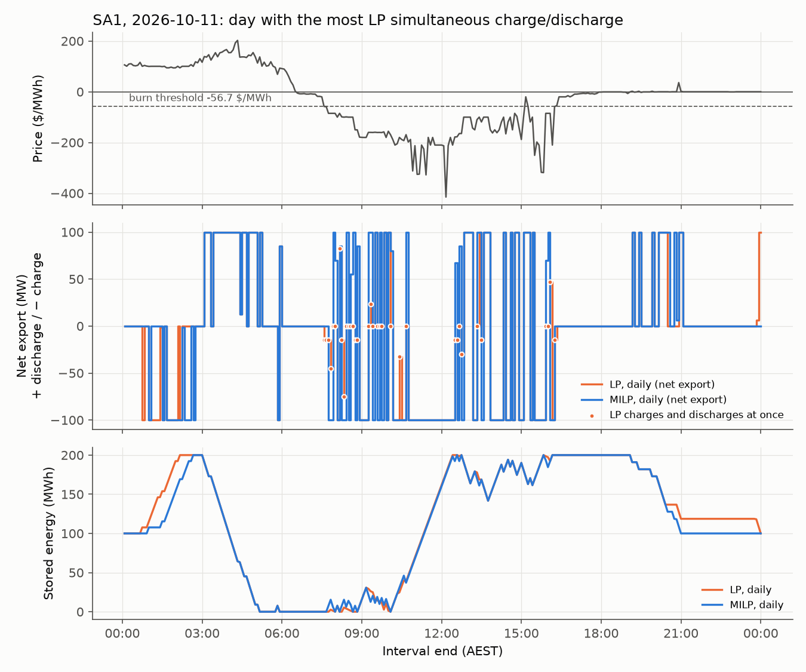
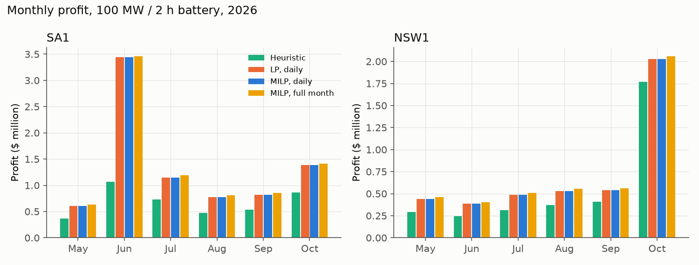
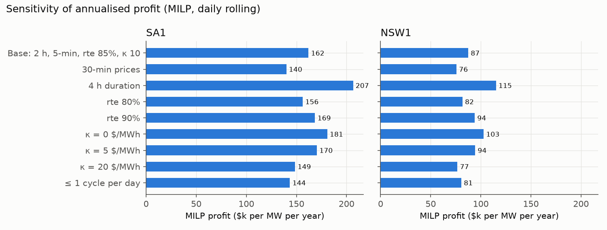

# Battery arbitrage in the NEM: LP vs MILP

<!-- README.md is generated from README.template.md by `make report`; edit the template. -->

How much could a grid-scale battery earn from energy arbitrage in South Australia (SA1) and New South Wales (NSW1)? This repository answers that with a small, reproducible optimisation study on AEMO 5-minute prices for May–October 2026 (184 days). It compares:

- a **linear program (LP)** with a **mixed-integer linear program (MILP)** that forbids charging and discharging at the same time;
- **daily rolling** solves with a **full-month** solve (an upper bound);
- **5-minute** with **30-minute** price resolution;
- the optimiser with a **one-cycle-per-day heuristic**.

Built with Pyomo + HiGHS. Developed with AI coding agents (Claude Code); the formulation, tests and results were checked by the author. All money is in Australian dollars (A$).

## Key results

Base case: 100 MW / 2 h battery, round-trip efficiency 85%, degradation cost 10 $/MWh discharged, perfect foresight, energy arbitrage only.

| Region | Strategy | Profit (6 months) | $/MW/year | Cycles/day | Simultaneous charge+discharge (intervals) |
|---|---|---|---|---|---|
| SA1 | Heuristic | $4.03 M | $80k | 0.72 | 0 |
| SA1 | LP, daily | $8.18 M | $162k | 2.10 | 143 |
| SA1 | MILP, daily | $8.17 M | $162k | 2.09 | 0 |
| SA1 | MILP, full month | $8.35 M | $166k | – | 0 |
| NSW1 | Heuristic | $3.40 M | $67k | 0.76 | 0 |
| NSW1 | LP, daily | $4.41 M | $87k | 1.73 | 0 |
| NSW1 | MILP, daily | $4.41 M | $87k | 1.73 | 0 |
| NSW1 | MILP, full month | $4.54 M | $90k | – | 0 |

Cycles are equivalent full cycles: energy delivered to the grid divided by usable energy capacity. "$/MW/year" scales the 184-day total to a year and therefore inherits the price spikes of this particular period (see below).

- **Profit is concentrated in a few extreme days.** With perfect foresight, the five best days give 42% of SA1 profit and 38% of NSW1 profit; the single best day (22 June 2026 in SA1, 12 October 2026 in NSW1) gives 25% and 28%. June alone gives 42% of SA1 profit and October 46% of NSW1 profit; in both months prices reached the market price cap.
- **The optimiser earns 2.03× the heuristic's profit in SA1 and 1.30× in NSW1.** Part of this is extra cycling: the heuristic makes at most about one cycle a day. Limited to one cycle a day, the MILP still earns 1.79× (SA1) and 1.20× (NSW1) the heuristic's profit, because it chooses *when* to cycle with the whole day in view. (The heuristic carries its state of charge across days and ends the period at 0 MWh in SA1 and 137 MWh in NSW1, against 100 MWh at the start; buying back the difference at the period's mean price would lower its profit by $8,276 (0.21%) in SA1 and raise it by $3,429 (0.10%) in NSW1.)
- **The LP overstates profit by $3,788 (0.05%) in SA1.** In 143 five-minute intervals it charges and discharges at the same time, so that efficiency losses dispose of energy: either to absorb more energy at a deeply negative price, or to make room in the battery for even more negative prices later. Either way this can only pay when the price is below the *burn threshold* −κ·rte/(1−rte) = −56.67 $/MWh; the highest price at which the LP did it was −57.90 $/MWh. NSW1 prices never fell that low (minimum −18.51 $/MWh), so there the LP and MILP give the same profit (difference $0).
- **Solving one day at a time captures 97.8% (SA1) and 97.2% (NSW1) of the full-month optimum.** The two differ only in the end-of-day condition: the daily solve forces the battery back to 50% at every midnight.
- **Resolution matters:** with 30-minute average prices the MILP earns 13.6% (SA1) and 13.4% (NSW1) less than with 5-minute prices.
- **Duration:** a 4 h battery earns 27.4% (SA1) and 31.7% (NSW1) more per MW than a 2 h battery.

These are perfect-foresight, price-taker numbers: an upper bound on energy-arbitrage revenue in this period, not a forecast of what a real battery would earn (see [Limitations](#limitations)).

## Model

For each interval $t$ of length $\Delta t$ hours with price $p_t$ ($/MWh):

| Symbol | Meaning |
|---|---|
| $c_t, d_t \in [0, P]$ | charging and discharging power (MW) |
| $e_t \in [E_{min}, E_{max}]$ | stored energy at the end of interval $t$ (MWh) |
| $E_{init}$ | stored energy at the start and required at the end of each window (MWh) |
| $u_t \in \{0, 1\}$ | MILP only: 1 if the battery may charge in interval $t$ |
| $\eta_c = \eta_d = \sqrt{rte}$ | charging and discharging efficiency |
| $\kappa$ | degradation cost per MWh discharged ($/MWh) |

$$\max \sum_t \Big[\, p_t\,(d_t - c_t)\,\Delta t \;-\; \kappa\, d_t\, \Delta t \,\Big]$$

subject to

$$e_t = e_{t-1} + \eta_c\, c_t\, \Delta t - \frac{d_t\, \Delta t}{\eta_d}, \qquad e_{-1} = E_{init}, \qquad e_{T-1} = E_{init}$$

and, in the MILP only,

$$c_t \le P\, u_t, \qquad d_t \le P\,(1 - u_t).$$

An optional cycle cap adds $\sum_t d_t \Delta t \le N \cdot (E_{max} - E_{min})$ per day (used with $N = 1$ in one scenario).

- **Objective:** the first term is the energy bought and sold at the spot price; the second is a linear stand-in for battery wear, charged per MWh discharged.
- **Why the LP can charge and discharge at once:** in any interval where both $c_t > 0$ and $d_t > 0$, lowering $c_t$ by $x$ and $d_t$ by $rte \cdot x$ leaves the stored energy unchanged, cuts grid purchases by $(1-rte)\,x$ and saves $\kappa \cdot rte \cdot x$ of degradation. At an optimum this cannot be an improvement, so simultaneous operation requires $p_t \le -\kappa\, rte / (1 - rte)$. This is a necessary condition, not a sufficient one. The binary $u_t$ rules simultaneous operation out. The tests check that every simultaneous interval in an LP solution lies below this threshold.
- **Shadow prices:** `model.solve(..., duals=True)` returns the dual of each energy-balance constraint, i.e. the value of one more MWh in storage at the end of that interval. The tests check it against the optimality conditions: it equals $p_t/\eta_c$ while charging below full power and $\eta_d (p_t - \kappa)$ while discharging below full power, and it stays constant while the state of charge is strictly between its limits.
- **Daily rolling:** each calendar day (NEM time, AEST) is solved separately, starting and ending at 50% state of charge. The **full-month** variant solves each month as a single problem with the same start and end condition.
- **Heuristic benchmark:** each day, mark the cheapest intervals needed to fill the battery and the dearest needed to empty it; skip the day if the average spread does not cover losses and degradation; then charge or discharge at full power in marked intervals, in time order, within the energy limits. It does not look at the order of prices within the day, and it makes at most about one cycle a day.

## Data

AEMO aggregated price and demand data, one CSV per region and month, downloaded by `bess/data.py` from
`https://www.aemo.com.au/aemo/data/nem/priceanddemand/PRICE_AND_DEMAND_YYYYMM_REGION.csv`.
`SETTLEMENTDATE` is the end of each 5-minute interval in NEM time (AEST, UTC+10). The raw files are cached in `data/raw/` and are not committed.

Every file is validated: continuous 5-minute timestamps for the whole month, no duplicates, no missing values, period type `TRADE`, and prices within the market price floor and cap for the relevant financial year. All 105,984 intervals passed.

| Region | Month | Intervals | Missing | Duplicates | Outside MPF–MPC | Mean ($/MWh) | Min | Max | Negative (%) |
|---|---|---|---|---|---|---|---|---|---|
| SA1 | May 2026 | 8928 | 0 | 0 | 0 | 77.49 | -45.73 | 349.09 | 12.8 |
| SA1 | Jun 2026 | 8640 | 0 | 0 | 0 | 125.73 | -21.68 | 20,300.00 | 19.4 |
| SA1 | Jul 2026 | 8928 | 0 | 0 | 0 | 95.89 | -204.05 | 16,970.86 | 19.1 |
| SA1 | Aug 2026 | 8928 | 0 | 0 | 0 | 71.62 | -496.77 | 375.79 | 13.8 |
| SA1 | Sep 2026 | 8640 | 0 | 0 | 0 | 37.71 | -294.71 | 358.57 | 30.1 |
| SA1 | Oct 2026 | 8928 | 0 | 0 | 0 | 49.70 | -414.98 | 3,210.98 | 32.9 |
| NSW1 | May 2026 | 8928 | 0 | 0 | 0 | 82.01 | -8.89 | 341.14 | 1.3 |
| NSW1 | Jun 2026 | 8640 | 0 | 0 | 0 | 83.30 | -5.01 | 299.99 | 0.3 |
| NSW1 | Jul 2026 | 8928 | 0 | 0 | 0 | 81.52 | -8.77 | 531.85 | 1.4 |
| NSW1 | Aug 2026 | 8928 | 0 | 0 | 0 | 75.71 | -18.51 | 311.91 | 2.3 |
| NSW1 | Sep 2026 | 8640 | 0 | 0 | 0 | 65.32 | -18.51 | 384.09 | 10.4 |
| NSW1 | Oct 2026 | 8928 | 0 | 0 | 0 | 127.83 | -10.50 | 23,200.00 | 0.6 |

Source: Australian Energy Market Operator (AEMO), *Aggregated price and demand data*, used under AEMO's copyright permissions, which allow use for any purpose with accurate attribution to AEMO.

## Parameters

| Parameter | Value | Source or status |
|---|---|---|
| Power | 100 MW | Assumption |
| Duration | 2 h (4 h in sensitivity) | Assumption |
| Round-trip efficiency | 85% (80% and 90% in sensitivity) | Assumption. For reference, the US utility-scale battery fleet averaged a monthly round-trip efficiency of 82% in 2019 (US EIA, *Today in Energy*, 12 February 2021). |
| Degradation cost κ | 10 $/MWh discharged (0, 5 and 20 in sensitivity) | Assumption |
| Cycle limit | none (≤ 1 equivalent full cycle per day in sensitivity) | Assumption |
| Energy limits | 0–100% of rated energy | Assumption (rated energy treated as usable; not varied) |
| Start and end-of-day state of charge | 50% | Assumption (not varied; the full-month solve relaxes it within each month) |
| Market price floor | −1,000 $/MWh | National Electricity Rules, clause 3.9.6 |
| Market price cap | 20,300 $/MWh (1 July 2025 – 30 June 2026), 23,200 $/MWh (1 July 2026 – 30 June 2027) | AEMC media release *AEMC updates market price cap for 2026-27*. Both caps appear as the maximum price in the data table above. |
| MILP optimality gap | 1e-06 (relative) | Solver setting |

## Results

### LP vs MILP: simultaneous charging and discharging

| Region | κ ($/MWh) | Burn threshold ($/MWh) | LP simultaneous intervals | Highest price among them | LP − MILP profit |
|---|---|---|---|---|---|
| SA1 | 0 | 0.00 | 3,812 | 0.00 | $24,881 (0.27%) |
| SA1 | 5 | -28.33 | 270 | -29.02 | $7,597 (0.09%) |
| SA1 | 10 | -56.67 | 143 | -57.90 | $3,788 (0.05%) |
| SA1 | 20 | -113.33 | 23 | -115.53 | $831 (0.01%) |
| NSW1 | 0 | 0.00 | 300 | 0.00 | $1,023 (0.02%) |
| NSW1 | 5 | -28.33 | 0 | – | $0 (0.00%) |
| NSW1 | 10 | -56.67 | 0 | – | $0 (0.00%) |
| NSW1 | 20 | -113.33 | 0 | – | $0 (0.00%) |

The lower the degradation cost, the higher the burn threshold and the more often the LP exploits it. With κ = 0 any non-positive price is enough. The interval counts need not be unique, because the LP can have several optimal schedules with the same profit; the profit gap is the robust measure.

What the base-case LP does in the intervals priced below the threshold:

| Region | Intervals below threshold | Charge and discharge at once | Full-power charging only | Full and idle | Other |
|---|---|---|---|---|---|
| SA1 | 1020 | 143 | 795 | 0 | 82 |
| NSW1 | 0 | 0 | 0 | 0 | 0 |



On 2026-10-11 the LP charged and discharged at once in 34 intervals, all at prices of −57.90 $/MWh or lower. The MILP schedule never does both.

### Monthly profit



Daily rolling vs full-month solve (MILP):

| Region | Month | Daily rolling | Full month | Daily / full |
|---|---|---|---|---|
| SA1 | May | $0.61 M | $0.64 M | 95.9% |
| SA1 | Jun | $3.44 M | $3.46 M | 99.5% |
| SA1 | Jul | $1.15 M | $1.19 M | 96.7% |
| SA1 | Aug | $0.77 M | $0.81 M | 95.4% |
| SA1 | Sep | $0.82 M | $0.85 M | 95.7% |
| SA1 | Oct | $1.38 M | $1.41 M | 98.1% |
| NSW1 | May | $0.44 M | $0.46 M | 96.0% |
| NSW1 | Jun | $0.39 M | $0.40 M | 96.4% |
| NSW1 | Jul | $0.49 M | $0.51 M | 95.6% |
| NSW1 | Aug | $0.53 M | $0.55 M | 95.4% |
| NSW1 | Sep | $0.54 M | $0.56 M | 96.2% |
| NSW1 | Oct | $2.03 M | $2.06 M | 98.7% |

### Sensitivity



| Scenario | SA1 $/MW/year | NSW1 $/MW/year | SA1 cycles/day | NSW1 cycles/day |
|---|---|---|---|---|
| Base: 2 h, 5-min, rte 85%, κ 10 | $162k | $87k | 2.09 | 1.73 |
| 30-min prices | $140k | $76k | 1.64 | 1.35 |
| 4 h duration | $207k | $115k | 1.34 | 1.16 |
| rte 80% | $156k | $82k | 1.86 | 1.44 |
| rte 90% | $169k | $94k | 2.35 | 2.09 |
| κ = 0 $/MWh | $181k | $103k | 3.40 | 2.57 |
| κ = 5 $/MWh | $170k | $94k | 2.49 | 2.08 |
| κ = 20 $/MWh | $149k | $77k | 1.63 | 1.28 |
| ≤ 1 cycle per day | $144k | $81k | 1.00 | 1.00 |

## Performance

Each daily problem has 288 five-minute intervals. The whole study (60 independent jobs) runs in parallel on 8 processes: 316 s wall-clock for 1279 s of solver time. Timings depend on the machine and on what else it is running.

- **LP vs MILP:** the 184 daily SA1 base-case solves took 5 s in total as LPs and 37 s as MILPs (299 s for the MILP with κ = 0). A whole month as one problem took 1.6–2.4 s as an LP and 12–117 s as a MILP.
- **LP algorithm:** solve time in seconds for each month-long LP (8,640–8,928 intervals), same optimum for every algorithm:

| Region | Month | HiGHS default (no options) | primal simplex | interior point (IPM) |
|---|---|---|---|---|
| SA1 | May 2026 | 0.8 | 0.9 | 0.9 |
| SA1 | Jun 2026 | 12.7 | 0.9 | 0.9 |
| SA1 | Jul 2026 | 0.8 | 0.9 | 1.0 |
| SA1 | Aug 2026 | 0.7 | 0.9 | 1.1 |
| SA1 | Sep 2026 | 0.6 | 0.9 | 0.9 |
| SA1 | Oct 2026 | 0.6 | 0.9 | 0.9 |
| NSW1 | May 2026 | 0.9 | 0.8 | 1.0 |
| NSW1 | Jun 2026 | 0.6 | 1.3 | 0.9 |
| NSW1 | Jul 2026 | 1.0 | 0.8 | 0.9 |
| NSW1 | Aug 2026 | 0.9 | 0.8 | 0.9 |
| NSW1 | Sep 2026 | 1.5 | 0.8 | 0.8 |
| NSW1 | Oct 2026 | 66.8 | 0.8 | 1.0 |

HiGHS with default options was slow on NSW1 October 2026 (67 s) and SA1 June 2026 (13 s), the two months whose prices reached the market price cap; on the other months it took at most 1.5 s. Primal simplex and the interior-point method took 0.8–1.3 s on every month, so the LPs here use primal simplex. Why the default struggles on those two months was not investigated; extreme price coefficients are one possible cause. `make bench` reproduces the table.

Other ways to speed up, not tried here: warm starts from the previous day's solution, solving the LP first and switching to the MILP only on days where the LP charges and discharges at once, and coarser time steps where accuracy allows.

## Limitations

- **Perfect foresight:** the battery knows every price of the day in advance. Real operation relies on forecasts, so these results are an upper bound. Because profit is concentrated in a few spike days, the gap to a forecast-based schedule could be large.
- **One six-month window:** May–October 2026 includes cap-level price events in both regions; annualised figures from this window should not be read as typical annual revenue.
- **Price-taker:** a 100 MW battery is assumed not to move prices, which is optimistic in a small region such as SA1.
- **Energy only:** frequency control ancillary services (FCAS), network charges and marginal loss factors are not modelled.
- **Cycling and degradation:** a fixed cost per MWh discharged, with no dependence on depth of discharge or state of charge and no capacity fade. Without a cycle limit the optimiser averages about two equivalent full cycles a day, which is high for a lithium-ion battery whose warranty limits throughput; the one-cycle-per-day scenario shows the cost of such a limit.
- **Fixed daily state-of-charge target:** the full-month comparison shows what this costs. The 50% level and the 0–100% usable range were not varied.
- **30-minute case:** prices are averaged to 30 minutes to measure the value of resolution; settlement in the NEM has been five-minute since October 2021.

## Next steps

Forecast-based scheduling (measure the share of perfect-foresight profit captured), FCAS co-optimisation, price impact, and a mini economic-dispatch model whose energy-balance shadow prices give marginal prices.

## How to run

Requires Python 3.12 and [uv](https://docs.astral.sh/uv/).

```bash
make env    # create .venv and install the pinned packages (requirements.lock)
make all    # download data, run tests, run all experiments, benchmark, figures, README
```

Individual steps, in order: `make data`, `make test`, `make run` (the slowest step), `make bench`, `make report`. `make report` needs the outputs of `make data` and `make run`.

| Path | Contents |
|---|---|
| `src/bess/data.py` | download, validation, 30-minute aggregation |
| `src/bess/model.py` | LP/MILP battery model (Pyomo) |
| `src/bess/heuristic.py` | one-cycle-per-day benchmark |
| `src/bess/backtest.py` | daily rolling and full-horizon runs, metrics |
| `src/bess/run.py` | all experiments, in parallel |
| `src/bess/bench.py` | HiGHS LP algorithm benchmark |
| `src/bess/report.py` | figures and this README |
| `tests/` | pytest: hand-calculated examples, energy balance, bounds, cycle cap, LP vs MILP, shadow prices, data checks |
| `results/` | generated tables and figures |

## Licence

Code: MIT (see `LICENSE`). Price data: © AEMO, not redistributed here; downloaded from AEMO and used under its copyright permissions with attribution.
